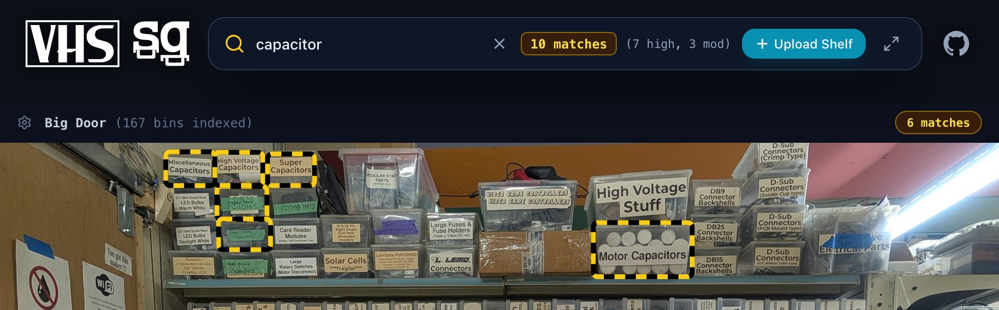

# spacegrep
A Hackerspace Visual Inventory Locator

spacegrep is a lightweight, self-contained visual inventory search appliance for hackerspaces, maker workshops, and electronics labs. It overlays high-resolution photos of component shelves, bins, and organizers with a real-time (< 50ms) hybrid (literal + semantic) search interface.



---

## Key Features

- **Automatic Indexing:** Add, replace, or remove shelf photos in the app or drop folder. New photos are automatically analyzed and indexed in seconds with live progress tracking.
- **Real-Time Keystroke Highlighting (< 50ms):** Bounding boxes highlight dynamically across your shelves as you type with zero search latency.
- **Hybrid Search (Literal + Semantic):**
  - **Literal:** Instant exact and fuzzy matches on part numbers, component codes, and drawer labels (`CR2032`, `ESP32`, `WLC100`, `Kapton`, `MOSFET`).
  - **Semantic:** Finds bins by functional intent or colloquial concept (`measure voltage` highlights Multimeters; `fix static shock` highlights ESD Wristbands; `heat resistant tape` highlights Kapton Tape).
- **High-Resolution Vision AI:** Accurately segments storage bins, transcribes fine-print labels, and identifies components across large, high-resolution shelf photos.
- **Visual Confidence & Radar:** Match confidence is displayed as a percentage with tiered highlights. Off-screen radar arrows point you directly toward matching bins above or below your current view.
- **Shelf Management:** Reorder shelves to match your physical workshop layout, rename shelves, or update photos without losing shelf positions.
- **Password-Protected Admin Mode:** Restricts photo uploading, reordering, and shelf deletion behind an admin password to protect shared workshop terminals.
- **Kiosk Auto-Reset:** Configurable 60-second inactivity reset timer for shared workshop terminals. Clears the search bar and smoothly scrolls to top when idle.
- **Appliance-Grade Deployment:** Self-contained, turnkey deployment with persistent local storage for all photos and catalog data.

---

## Quick Start (Local Development)

### 1. Requirements
- Python 3.11+
- Node.js 20+

### 2. Setup Environment
```bash
# Clone repository and enter directory
cd spacegrep

# Install backend virtualenv, dependencies, and frontend packages
make install

# Or set up manually:
python3 -m venv .venv
source .venv/bin/activate
pip install -r requirements.txt
cd frontend && npm install && npm run build && cd ..
```

### 3. Configure Environment Variables
Create a `.env` file from the template:
```bash
cp .env.example .env
```
Key configuration options:
- `GEMINI_API_KEY`: Google Gemini API key (obtainable from [Google AI Studio](https://aistudio.google.com/apikey)). Required for live vision segmentation and OCR; if omitted or blank, spacegrep falls back to an offline mock detector for testing.
- `ADMIN_PASSWORD`: Admin password required to upload new shelf photos or modify shelves in the web UI. If left blank, web uploads and shelf modifications are disabled (read-only kiosk mode).
- `GEMINI_MODEL`: Gemini model for vision detection (defaults to `gemini-3.6-flash`).
- `WHITEBOX_LOGO_URL` / `WHITEBOX_LINK_URL`: Optional custom SVG/image logo and link URL for white-labeling the top omnibar.
- `SLACK_BOT_TOKEN`: Optional Slack Bot User OAuth Token (`xoxb-...`) to enable the Slack integration.
- `SLACK_APP_TOKEN`: Slack App-Level Token (`xapp-...`) with `connections:write` scope for Socket Mode.
- `SLACK_CHANNEL_ID`: The specific Slack channel ID to monitor for photo uploads and queries (e.g. `C0123456789`).
- `SPACEGREP_BASE_URL`: Public base URL used when constructing clickable search links sent in Slack thread replies (defaults to `http://localhost:8000`).

### 4. Run the Appliance
```bash
# Run backend serving built frontend static assets
make run

# Or run backend and frontend dev server concurrently (with hot reloading)
make dev
```
Open your browser to:
```
http://localhost:8000
```
*(If running `make dev`, the Vite frontend dev server runs at `http://localhost:5173` with proxying to the backend at `:8000`).*

---

## Running with Docker Compose

For a turnkey deployment on a workshop NUC, Raspberry Pi, or local server with automatic HTTPS:

```bash
# 1. Configure your environment
cp .env.example .env
# Edit .env to supply your GEMINI_API_KEY, ADMIN_PASSWORD, and optional DOMAIN_NAME

# 2. Build and start containers
docker compose up -d
```
Access the application at `http://localhost:8000` (direct) or `http://localhost` / `https://<DOMAIN_NAME>` (via the included Caddy reverse proxy).

All database records (`inventory.db`), processed images, and seed photos persist on the host under `./data/`.

---

## Ingesting Workshop Photos

There are two easy ways to add photos of your workshop shelves:

### Method 1: Drop Folder (Automated on Boot)
1. Place any shelf photos (`.jpg`, `.jpeg`, `.png`, `.webp`) into:
   ```
   ./data/seed_photos/
   ```
2. Restart the app (or run `make seed`).
3. The server scans for unindexed photos (deduplicating by image hash), processes and compresses web-optimized images, calls Gemini Flash to detect storage bins and transcribe labels with semantic tags, and registers them in SQLite.

### Method 2: In-App Drag and Drop
1. Click **Upload Shelf** in the top omnibar (enter your admin password if prompted).
2. Drag and drop any shelf photo.
3. Watch the real-time progress banner (streamed via SSE) as Gemini detects bounding boxes, extracts labels, and indexes semantic tags across image tiles. The shelf will appear in the stream immediately.

### Method 3: Slack Bot Upload (Channel Integration)
Upload shelf photos or updates directly from your workshop Slack channel:
1. Configure `SLACK_BOT_TOKEN`, `SLACK_APP_TOKEN`, and `SLACK_CHANNEL_ID` in your `.env`.
2. Post or drag any shelf photo directly into the designated Slack channel.
3. The bot reacts with `:eyes:` to acknowledge receipt.
4. Gemini inspects the photo for community guidelines (reminding members of policy if visible faces or blurry lighting are detected) and determines whether the photo is an updated angle/reorganization of an existing shelf or an entirely new shelf.
5. Once ingested, the reaction transitions to `:white_check_mark:` and the bot thread-replies with the count of detected bins and a direct link to view the shelf live in Spacegrep!

---

## Slack Location Search ("Where is X?")

Members in your workshop Slack channel can quickly ask where tools or components are stored:
- Example queries:
  - `"Where is the kapton tape?"`
  - `"Where are 10k resistors?"`
  - `"Where can I find ESP32?"`
  - `"@spacegrep find multimeter"`
- The bot replies in the thread with an inventory summary and a constructed URL (e.g. `https://spacegrep.lan/?q=kapton+tape`).
- Clicking the link takes the user directly to Spacegrep with their search query pre-loaded, the matching bins highlighted, and smoothly centered. Kiosk auto-reset is automatically paused for deep-linked search sessions.

---

### Managing Existing Shelves
When authenticated as an admin, each shelf card features a quick-action menu (•••) allowing you to:
- **Rename:** Update the display title of the shelf.
- **Move Up / Down:** Adjust the physical reading order of shelves in your workshop.
- **Replace:** Upload an updated photo (e.g., after reorganizing bins) to re-index labels while preserving shelf ID and position.
- **Delete:** Remove the shelf, all its bin annotations, and image files from disk.

---

## Keyboard Shortcuts

| Key | Context | Action |
| --- | --- | --- |
| `/` | Global | Focus search bar from anywhere and select query text |
| `Escape` | Global | Clear search query and blur search bar |
| `Enter` | Search Bar | Defocus search and smoothly center the first or active match |
| `n` | Global (outside search) | Cycle to the next matching bin and center it (vi/less style) |
| `N` / `Shift + n` | Global (outside search) | Cycle to the previous matching bin and center it (vi/less style) |
| `Space` | Global (outside search) | Smoothly scroll to the next shelf image boundary below the search bar |
| `Shift + Space` | Global (outside search) | Smoothly scroll to the previous shelf image boundary (or snap to top of current) |
| `q` / `Q` | Global (outside search) | Quick reset: clear search, scroll to top, and reset kiosk timer |

*(Tip: You can also click any off-screen **Radar Arrow** indicator or shelf match badge to smoothly scroll and center that bin).*

---

## Testing

Run the automated backend test suite:
```bash
make test
```
Verifies:
- Normalized coordinate mapping ($0..1000 \rightarrow 0.0..1.0$)
- High-resolution SAHI-style image tiling and global coordinate projection
- IoU overlap calculations and Non-Maximum Suppression (NMS) duplicate suppression
- Image compression and thumbnail generation
- SQLite persistence, cascading deletes, custom ordering, and SHA-256 deduplication
- Ingestion pipeline, offline mock detection fallback, and startup auto-seed scanner
- REST API endpoints for manifest, configuration, and photo management (upload, replace, rename, move, delete)
- SSE streaming progress events and stage tracking
- Admin password authentication, signed Bearer tokens, and rate limiting
- Security hardening (path traversal defense, CORS origin isolation, security headers, upload size enforcement)
